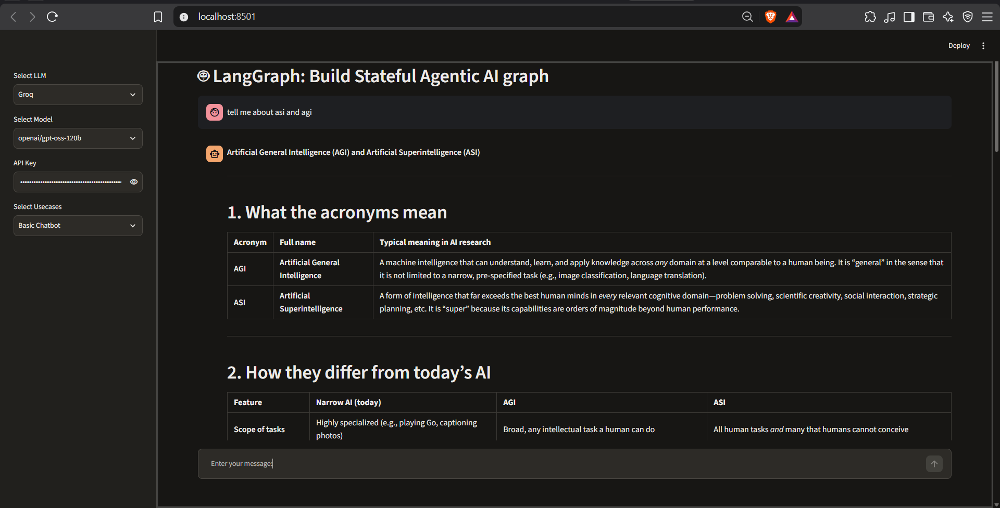
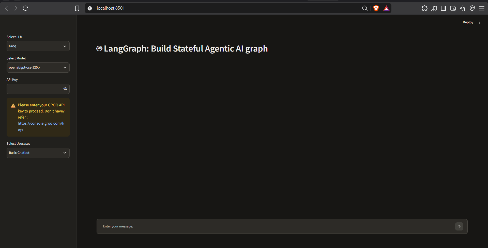

# 🤖 Stateful AgenticBot

A **stateful AI chatbot** built with **LangGraph**, **LangChain** and **Groq**, with a simple **Streamlit** interface. Pick a Groq model, enter your API key, choose a use case, and start chatting.

## 📸 Screenshots

### chat UI


### Main Action


## ✨ Features

- Graph-based chatbot flow using **LangGraph** (nodes, edges and state)
- Fast LLM inference through the **Groq API** (`langchain-groq`)
- Streamlit sidebar to select the **LLM**, **model** and **use case**
- Settings (page title, model list, use cases) kept in a simple `.ini` config file, so they can be changed without touching the code
- Currently supported use case: **Basic Chatbot**

## 🛠️ Tech Stack

| Tool | Purpose |
|---|---|
| Python 3.11 | Language |
| LangGraph | Building the stateful agent graph |
| LangChain / langchain-groq | LLM integration |
| Groq | LLM provider (free tier available) |
| Streamlit | Web UI |
| uv | Dependency management |

## 📁 Project Structure

```
Stateful-Agentic-AI-Graph-Application/
├── app.py                         # Entry point (runs with Streamlit)
├── pyproject.toml                 # Project dependencies (uv)
├── requirements.txt               # Dependencies (pip)
├── uv.lock                        # Locked dependency versions
├── .python-version                # Python version
├── Screenshot/                    # README screenshots
└── src/
    └── langgraphagenticai/
        ├── main.py                # Connects the UI, LLM and graph
        ├── graph/                 # Graph building (nodes + edges)
        ├── nodes/                 # Individual graph nodes
        ├── state/                 # Graph state definition
        ├── tools/                 # Tools for the agent
        ├── LLMS/
        │   └── groqllm.py         # Creates the Groq chat model
        └── ui/
            ├── streamlitui/       # Streamlit sidebar and page layout
            ├── uiconfigfile.ini   # UI settings (title, models, use cases)
            └── uiconfigfile.py    # Reads the .ini config
```

## 🚀 Getting Started

### 1. Clone the repository

```bash
git clone https://github.com/Codeabhi096/Stateful-Agentic-AI-Graph-Application.git
cd Stateful-Agentic-AI-Graph-Application
```

### 2. Create the environment and install dependencies

Using **uv** (recommended):

```bash
uv sync
```

Or using **pip**:

```bash
python -m venv .venv
.venv\Scripts\activate        # Windows
pip install -r requirements.txt
```

### 3. Get a Groq API key

Create a free key at [console.groq.com/keys](https://console.groq.com/keys). No credit card is needed for the free tier.

### 4. Run the app

```bash
streamlit run app.py
```

Then, in the sidebar:
1. Select **Groq** as the LLM
2. Select a model
3. Paste your **Groq API key**
4. Select the use case **Basic Chatbot** and start chatting

## ⚙️ Configuration

Edit `src/langgraphagenticai/ui/uiconfigfile.ini`:

```ini
[DEFAULT]
PAGE_TITLE = LangGraph: Build Stateful Agentic AI graph
LLM_OPTIONS = Groq
USECASE_OPTIONS = Basic Chatbot
GROQ_MODEL_OPTIONS = openai/gpt-oss-120b, openai/gpt-oss-20b, qwen/qwen3.8-27b
```

- Separate multiple values with commas.
- Use **chat models only**. Safety/guard models (such as `llama-prompt-guard` or `gpt-oss-safeguard`) will not work for chat.

## ⚠️ Notes

- **Model availability changes often.** If you see a `model_decommissioned` or `model_not_found` error, the model is no longer available. Check the current list at [console.groq.com/docs/models](https://console.groq.com/docs/models) or run:

  ```bash
  curl https://api.groq.com/openai/v1/models -H "Authorization: Bearer $GROQ_API_KEY"
  ```

- The Groq free tier has rate limits per model (requests and tokens per minute and per day). If you hit a `429` error, wait for the limit to reset or switch to another model.
- Preview models (for example Qwen) can be discontinued at short notice.
- Never commit your API key to GitHub.
